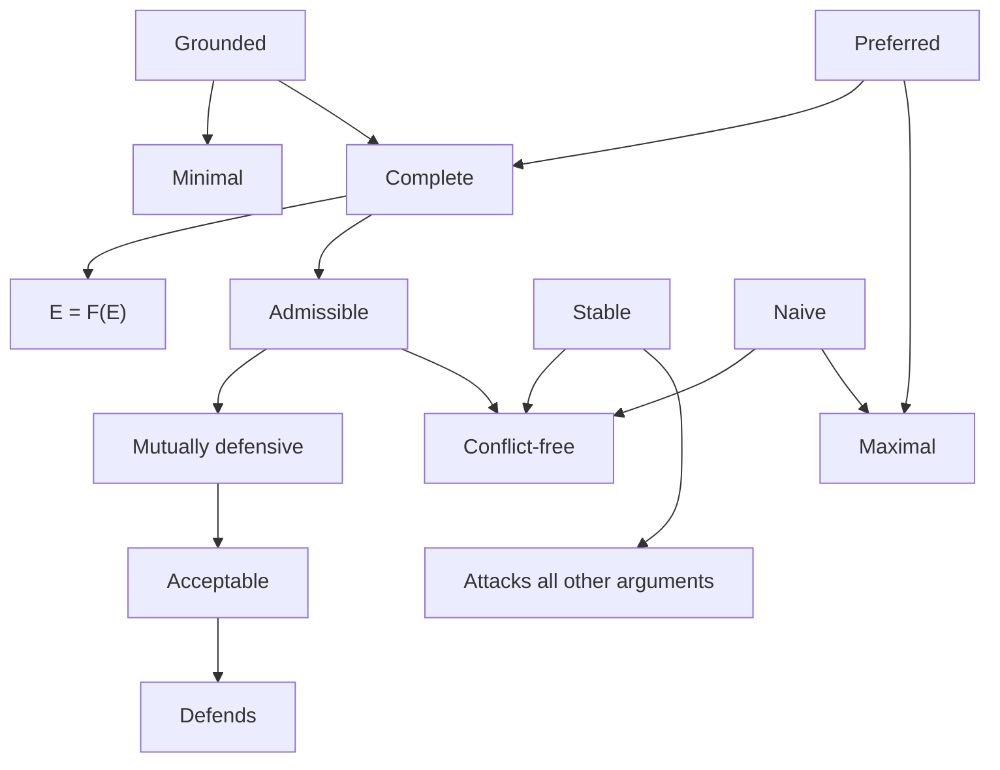

## Symbols and Terms
- **Entails:** $\models$
	- **Contradiction:** $\bot$
- **Derivation:** $\vdash$
	- **Inconsistency:** $\Box$
- **Literal:** variable or its negation
- **Clause:** Disjunction of literals ($\lor$/or)
- **Resolvant:** If 2 clauses have literals that are each others complement, remove both and merge clauses

$P \rightarrow Q = \neg P \lor Q$

## Resolution Principle
Used to prove whether an argument is correct. 

## Abstract Argumentation (Dung)
$AF =(A, R)$ where $A$ is a set of arguments and $R$ is a set of attack relations

$aRb \land bRc \rightarrow a$ defends $c$ against $b$

Position $S \subseteq A$:
- Argument $a$ is **acceptable** with respect to $S$ if $S$ defends $a$
	- **Credulously accepted** with respect to $AF$ if $\exists_{p \in pref(A)} \space a \in p$
	- **Skeptically accepted** with respect to $AF$ if $\forall_{p \in pref(A)} \space a \in p$
- **Conflict-free** if $\neg \exists_{a, b \in S} \space aRb$ 
- **Mutually defensive** if $\forall_{a \in S} \space acceptable(a, S)$
- **Admissible** if conflict-free and mutually defensive

$F(S) = \{a | a \in S \text{ if } acc(a, S)\} \text{ ie. returns each argument is defended/not attacked under }S$

Extension $E \subseteq A$ (types of positions):
- **Naive** if conflict-free and maximal (no conflict-free superset exists)
- **Stable** if conflict-free and every other arogument in $A$ is attacked by $E$
- **Complete** if admissible and $E = F(E)$
- **Grounded** if complete and minimal (no complete subset exists)
	- Claim: there is always a unique grounded extension, and for finite $AF$ it can be found by iteratively applying $F$ to $\emptyset$ 
	- $AF$ is well-founded if it contains no cycles. For such, the grounded extension is the only preferred and stable extension
- **Preferred** if complete and maximal

### Labeling:
$$\mathcal{L}: A \rightarrow \{in, out, undecided\}$$
$$\mathcal{L}(a)=in \iff \forall(\mathcal{L}(b) = out \space | \space (b, a) \in R) \text{ ie. all attacking a are out}$$
$$\mathcal{L}(a)=out \iff \exists(\mathcal{L}(b) = in \space | \space (b, a) \in R) \text{ ie. an in-argument attacks a}$$
$$\mathcal{L}_{in} \cup \mathcal{L}_{out} = \emptyset, \space \mathcal{L}_{in} \cap \mathcal{L}_{out} = A$$
Preferred if $\mathcal{L}_{in}$ is maximal among all labelings, ie. $$\mathcal{L}_{in} \in pref(S)$$
1
